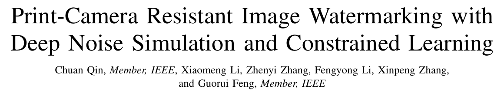

# Print-Camera Resistant Image Watermarking with Deep Noise Simulation and Constrained Learning



**Chuan Qin, Xiaomeng Li, Zhenyi Zhang, Fengyong Li, Xinpeng Zhang, and Guorui Feng**  
*IEEE Transactions on Multimedia*, vol. 26, pp. 2164-2177, 2024.  
[Paper](https://ieeexplore.ieee.org/document/10175655) · [Upstream code](https://github.com/davidgdd1/Print-Camera-resilient-watermarking/tree/0dc44bd09d186aed242f07c863b17c222964292c) · [Experiment dataset](https://drive.google.com/drive/folders/1asrLEHupz25W5jB_69hmZe3mbWKdrknf?usp=sharing)

## Overview

This work presents an image watermarking method for the print–camera channel. A learned noise simulation network models distortions introduced by printing and camera capture. Constrained learning based on just-noticeable differences (JND) guides watermark embedding to limit visible changes.

## Code

| Entry point | Purpose |
| --- | --- |
| [`model_f.py`](train_code/model_f.py) | Defines the watermark encoder, decoder, noise simulation network, and training losses. |
| [`train_f.py`](train_code/train_f.py) | Configures the TensorFlow training workflow. |

## Experiment setup

The implementation uses 400 × 400 RGB images and a 100-bit watermark by default. The print–camera dataset provides paired images for noise simulation. Watermark training uses separate COCO cover images. See the [data setup](docs/DATA_AND_PATHS.md) and [dependencies](docs/DEPENDENCIES.md).

## Citation

```bibtex
@article{qin2024printcamera,
  author  = {Chuan Qin and Xiaomeng Li and Zhenyi Zhang and Fengyong Li and Xinpeng Zhang and Guorui Feng},
  title   = {Print-Camera Resistant Image Watermarking with Deep Noise Simulation and Constrained Learning},
  journal = {IEEE Transactions on Multimedia},
  year    = {2024},
  volume  = {26},
  pages   = {2164--2177},
  doi     = {10.1109/TMM.2023.3293272}
}
```
