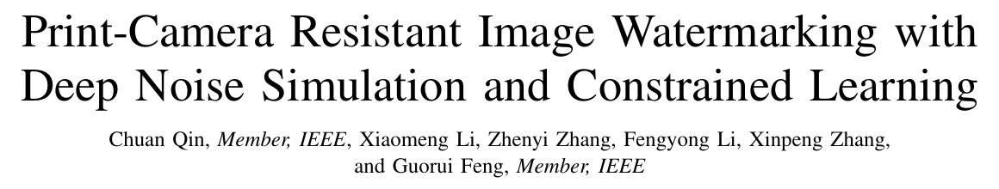

# Print-Camera Resistant Image Watermarking with Deep Noise Simulation and Constrained Learning



**Chuan Qin, Xiaomeng Li, Zhenyi Zhang, Fengyong Li, Xinpeng Zhang, and Guorui Feng**  
*IEEE Transactions on Multimedia*, vol. 26, pp. 2164-2177, 2024.  
[Paper / DOI](https://doi.org/10.1109/TMM.2023.3293272)

This is a **laboratory-maintained source archive** associated with the paper. It preserves the two supplied Python files and documents their inputs, dependencies, outputs, and unresolved runtime requirements. It does not claim official implementation status or a complete paper reproduction.

> **Status: documented, not runnable as supplied.** Both files passed static syntax checks, but missing helper modules and an unprepared TensorFlow environment prevent an end-to-end run. At the user's request, no source repair, helper substitution, package installation, training, or inference was performed. See [VALIDATION.md](docs/VALIDATION.md).

## Scope of the supplied code

- Framework style: TensorFlow `compat.v1`, graph placeholders, sessions, and Keras layers.
- Default input: 400 x 400 RGB images and a randomly generated 100-bit message.
- Main model components: `StegaStampEncoder`, spatial-transformer-based `StegaStampDecoder`, `nsn`, and `Discriminator`.
- Training graph: image/YUV loss, message loss, perceptual/JND constraints, optional adversarial loss, and mathematical/learned noise paths.
- The learned-noise branch is selected after a hardcoded global-step threshold of 100,000. This is a code observation, not a validated result.

The local resource directory contains two paired image folders with 7,080 JPG files each and matching filename sets. That inventory does **not** verify image alignment or quality. Datasets, weights, environments, logs, and the full paper are excluded from this lightweight release.

## Repository layout

```text
.
├── README.md
├── .gitignore
├── assets/paper_header.png
├── train_code/
│   ├── model_f.py                # Supplied model and loss definitions, unchanged
│   └── train_f.py                # Supplied training entry, unchanged
├── docs/
│   ├── DEPENDENCIES.md           # Required modules and unresolved compatibility
│   ├── DATA_AND_PATHS.md         # Inputs, pairing assumptions and output locations
│   ├── KNOWN_ISSUES.md           # Concrete blockers and static observations
│   ├── VALIDATION.md             # What was actually checked, and what was not
│   ├── THIRD_PARTY.md
│   └── source_sha256.txt
└── GITHUB_UPLOAD_GUIDE_zh.md
```

Both original Python files are preserved byte-for-byte. Their code structure, model definitions, losses, constants, and comments were not rewritten. No substitute implementations of missing files were added.

## Dependencies: resolve these before running

The project needs NumPy, Pillow, TensorFlow with the used v1-compatibility APIs, and TensorFlow Addons. It additionally imports **local helper code that was not supplied**:

| Missing module | Used for |
| --- | --- |
| `utils.py` | Random image transforms, blur, brightness, differentiable JPEG and related functions |
| `stn.py` | `spatial_transformer_network` used by the decoder |
| `lpips/lpips_tf.py` | TensorFlow-based perceptual losses |

The similarly named PyTorch `lpips` package is not automatically a replacement for `lpips.lpips_tf`. The source also imports private `tensorflow.python.keras` modules, so compatibility cannot be inferred from simply installing the latest TensorFlow/Keras packages.

No original environment lock or tested dependency versions were supplied. Therefore this archive does **not** invent a runnable `requirements.txt` or offer an unverified one-command installation. A read-only check of the available framework environment found no TensorFlow, TensorFlow Addons, or Keras installation. No package was installed or upgraded. See [DEPENDENCIES.md](docs/DEPENDENCIES.md).

## Data, paths, and checkpoints

`train_f.py` defines these module-level constants; they are not command-line data-path options:

| Constant | Current behavior |
| --- | --- |
| `TRAIN_PATH` | A previous machine's absolute Linux directory; unavailable in this release |
| `TRAIN_NOISE_PATH` | `./train_class`, resolved from the process working directory |
| `TRAIN_NOISE_PS_PATH` | `./train_ps_class`, resolved from the process working directory |
| `LOGS_Path` | `./logs/` |
| `CHECKPOINTS_PATH` | `./checkpoints/` |
| `SAVED_MODELS` | `./saved_models` |

The original paired data remains outside the release. See [DATA_AND_PATHS.md](docs/DATA_AND_PATHS.md) for its expected layout and important filename-order assumptions. No pretrained checkpoint was supplied, and this archive does not provide an invented download URL. `--pretrained` expects a TensorFlow checkpoint prefix, not a PyTorch model or an arbitrary directory.

## Future execution sequence — not tested commands

Before any run, recover and review the missing helpers, prepare a separate compatible environment, verify the data and pairing, and adjust the hardcoded paths in a separately authorized restoration. None of those repair actions was performed for this archive.

After those prerequisites are resolved, the original entry point is:

```text
cd train_code
python train_f.py --help
```

Even `--help` is **currently blocked** because imports happen before argument parsing. Importing the entry can also create a `checkpoints/` directory. Do not use it as a harmless import probe in an unrelated working directory.

The source exposes `--exp_name`, `--secret_size`, `--batch_size`, `--num_steps`, `--lr`, `--pretrained`, noise settings, loss schedules, and `--no_gan`. The default loop runs 140,000 steps; do not click-run it casually. Listing these options from source does not certify that a shortened run works. The image size is hardcoded to 400, and some loading/export assumptions need review before training.

The training entry is designed to write TensorBoard summaries, periodically save checkpoint prefixes, and export a SavedModel after the loop. These are **intended outputs read from the source**, not outputs produced during preparation. The checkpoint/output folders are ignored by Git.

## Validation and limitations

- Static parsing/compilation passed for the two supplied files without importing them.
- Source checksums match the original files.
- The paired image folder counts and filename sets were checked without copying the dataset.
- The paper title/authors/DOI and final publication fields were checked against the supplied PDF and Crossref record.
- No model import, graph construction, training iteration, inference, watermark recovery, GPU computation, or physical print-camera test was performed.

Do not treat the source's `bit_acc` and `str_acc` summary labels as verified metrics: the expressions require review, as detailed in [KNOWN_ISSUES.md](docs/KNOWN_ISSUES.md). That file also records unresolved helper, path, pairing, and numerical concerns without silently fixing them.

## Citation

The supplied PDF is an accepted-author version carrying a 2023 DOI/copyright notice; the DOI registration record lists the final journal article in volume 26 (2024).

```bibtex
@article{qin2024printcamera,
  author  = {Chuan Qin and Xiaomeng Li and Zhenyi Zhang and Fengyong Li and Xinpeng Zhang and Guorui Feng},
  title   = {Print-Camera Resistant Image Watermarking with Deep Noise Simulation and Constrained Learning},
  journal = {IEEE Transactions on Multimedia},
  year    = {2024},
  volume  = {26},
  pages   = {2164--2177},
  doi     = {10.1109/TMM.2023.3293272}
}
```

## Provenance, license, and GitHub upload

No software LICENSE or helper provenance record accompanied the two source files. This release does not assign MIT/Apache or treat the paper's publication permissions as a software license. Any recovered third-party helper must retain its applicable notices; see [THIRD_PARTY.md](docs/THIRD_PARTY.md).

The title image is a genuine crop of the supplied paper. The complete paper, original archive, full datasets, and runtime assets are not part of the GitHub file set. For Chinese CMD instructions, use [GITHUB_UPLOAD_GUIDE_zh.md](GITHUB_UPLOAD_GUIDE_zh.md). No repository has been created, committed, or pushed by this preparation.
